<h1 align="center">xworkflows</h1>

<p align="center">
  <strong>A complete workflow for AI coding agents, enforced by hooks.</strong><br>
  Think first, plan, build in small steps, get reviewed, and never push broken work.
</p>

<p align="center">
  <a href="#quick-start"></a>
  <a href="#the-method-in-seven-steps"></a>
  <a href="docs/design.md"></a>
</p>

<p align="center">
  <a href="LICENSE"></a>
  
  
  
  <a href="https://github.com/omarperezr/xworkflows/stargazers"></a>
</p>

<p align="center">
  
</p>

## Why

AI coding agents are fast. Left alone, they also start before the design is clear, read far more than they need, and skip tests and reviews when nobody checks.

xworkflows installs into your repository and turns good habits into rules that are **enforced**. A rule the agent can ignore is a wish. A hook that blocks the action is a rule.

| Without xworkflows | With xworkflows |
|---|---|
| The agent writes code before the design is settled | A hook blocks the spec until the agent has asked you the design questions |
| The main session reads whole files and burns tokens | Cheap helper agents do the reading; a hook denies long reads in the main session |
| A fix lands with no test | `git push` is refused unless the fix has a test that failed before it |
| A change reaches `main` with no review | `git push` to `main` is refused until a reviewer has signed the plan |
| Nobody knows what is left to do | One pending list, checked on every push |

## Quick start

You need [Node.js](https://nodejs.org) 22 or newer, git and [Claude Code](https://claude.com/claude-code). Nothing else is installed: xworkflows has no dependencies.

**1. Install it.** Run this in the root of your project (a git repository):

```bash
npx github:omarperezr/xworkflows install
```

It prints every file it writes and ends with:

```
Next: open Claude Code and type /adapt
```

**2. Check it.**

```bash
npx github:omarperezr/xworkflows doctor
```

`doctor` prints one line per thing it checked, and each problem line ends with the way to fix it. Right after the install you see `ok` lines and ten lines like this one, which is expected:

```
fail not configured: paths.code (needed by fix-has-test, graph-current), run /adapt
```

**3. Teach it your project.** Open Claude Code in the project and type `/adapt`. It studies your code and its history, shows you a summary, asks you about what it found, and then writes the rules for your project. After that, `doctor` has nothing left to say about `/adapt`.

**4. Start working.** Type `/next-step`: it shows what is left to do, and `/next-step` hands the chosen step to `/deepen`, the first stage of the method.

Good to know:

- Nothing is committed or pushed for you. You decide when to commit what the installer wrote.
- The installer asks a question only when something of yours is already there: a skill or agent with the same name, a git hook, a file it did not write.
- `install --dry-run` shows what would be written and writes nothing.
- `uninstall` takes back what `install` added and leaves your files.
- Each clone or worktree runs `install` once for itself: the index of the notes (`.qmd/index.yml`) holds a path of that machine, so it is not tracked.
- It makes no network calls. There is no telemetry.

## What a refused push looks like

A commit that says `fix:` and brings no test does not leave your machine:

```
$ git push
fix-has-test: a fix needs a test that fails before it and passes after it
  5953603 fix: charge tax on the total: it changes code and adds no test file
  add the test to the fix commit, or put `no-test: <reason>` in its body, or `no-test-for: <sha7+> <reason>` in a later commit
xworkflows check: 1 of 11 failed
error: failed to push some refs
```

Add the test to the commit and the same push goes through.

## The method in seven steps

| # | Step | What happens | What enforces it |
|---|---|---|---|
| 1 | Deepen | Your request is rewritten the way a top professional of its field would ask it, with facts found in your code | the `deepen` skill |
| 2 | Design questions | The agent asks you the decisions, with its recommended answer each time | the `design-first` hook: no spec before the questions |
| 3 | Plan | A written plan of small tasks, tied to one of your goals | the `goal-cited` check |
| 4 | Implement | Small batches, each task done by its own agent, test first | the `orchestrator` hook, the `fix-has-test` and `change-size` checks |
| 5 | Review by risk | A reviewer checks each batch; risky paths get a stricter one | the `review-seal` check |
| 6 | Brakes | A check that refuses `git push` when something is missing | 14 checks, run by a pre-push hook |
| 7 | Pending list | One living list of what is left to do | the `pending` check |

## What gets installed

| | Count | Where |
|---|---|---|
| Skills | 13 | `.claude/skills/` |
| Agents | 7 | `.claude/agents/` |
| Hooks | 7 | `.xworkflows/hooks/`, registered in `.claude/settings.json` |
| Push checks | 14, plus 3 optional tool packs | `.xworkflows/checks/`, run by `.git/hooks/pre-push` |

It also writes a short block in `AGENTS.md`, a memory folder (`docs/memory`) where the agent keeps its notes, and a `.graphifyignore` that keeps the method's own files out of your code graph. Your settings live in `.xworkflows/config.json`, which `/adapt` writes.

<details>
<summary><strong>The 14 checks that can refuse a push</strong></summary>

| Check | It refuses the push when |
|---|---|
| `signature` | a commit carries an AI author or co-author line |
| `review-seal` | a code commit going to the main branch has no review seal in its plan |
| `goal-cited` | a plan does not name one of your goals |
| `pending` | the pending list breaks its own rules |
| `fix-has-test` | a `fix` commit has no test, or its test also passes without the fix |
| `change-size` | a branch changes more than 800 code lines (it warns at 400) |
| `comment-ratio` | more than 20 % of the new code lines are comments |
| `skills-travel` | an agent names a skill that is not committed in the repository |
| `patterns` | a new line matches a pattern your project forbids |
| `ratchet` | a debt your project counts went up |
| `graph-current` | the code graph is older than the pushed commit |
| `stale-memory` | a memory note names a path that no longer exists |
| `index-current` | the memory index is not up to date |
| `project` | your project's own commands (tests, type check) fail |

Some checks run only on a push to the main branch, so a push of a work branch runs fewer.

</details>

<details>
<summary><strong>Other tools it works with</strong></summary>

`/adapt` needs the `graphify` command installed and Claude Code's `Workflow` tool; without `graphify` it stops and tells you so. The agent's notes are searched with [`qmd`](https://www.npmjs.com/package/@tobilu/qmd) (`npm install -g @tobilu/qmd`); `doctor` prints the version it found and tells you when it is missing or does not read the project's index.

</details>

## Commands

| Command | What it does |
|---|---|
| `xworkflows install` | Installs the method into the current repository. `--dry-run` writes nothing; `--yes` answers the questions for scripts |
| `xworkflows doctor` | Checks the install and names the fix for each problem |
| `xworkflows check` | Runs the push checks by hand |
| `xworkflows uninstall` | Removes what `install` added |

Run each one as `npx github:omarperezr/xworkflows <command>`.

## Status

This is an early version (0.1.0). It is tested in real Claude Code sessions. Known limits are listed in [docs/gaps.md](docs/gaps.md), and the full design is in [docs/design.md](docs/design.md).

| Tool | Status |
|---|---|
| Claude Code | **tested** in real sessions |
| Codex | planned: config written from the official docs, not run yet |
| Cursor | planned: config written from the official docs, not run yet |
| Gemini CLI | planned: config written from the official docs, not run yet |

## Develop

```bash
git clone https://github.com/omarperezr/xworkflows.git
cd xworkflows
node --test "**/*.test.mjs"
```

Every test passes on a fresh clone. The folder `proof/` is for development only: it runs the method in throwaway copies of a repository through the Claude Agent SDK, a development dependency the installer never uses.

## License

MIT. The `grill` skill is adapted from [mattpocock/skills](https://github.com/mattpocock/skills) (MIT). The `thermo-nuclear-review` and `thermo-nuclear-code-quality-review` skills are adapted from [cursor/plugins](https://github.com/cursor/plugins) (MIT). The `tdd` skill comes from [obra/superpowers](https://github.com/obra/superpowers) (MIT), and `ponytail` and `ponytail-review` from [DietrichGebert/ponytail](https://github.com/DietrichGebert/ponytail) (MIT). Each one keeps its license and a `SOURCE.md` beside it.
